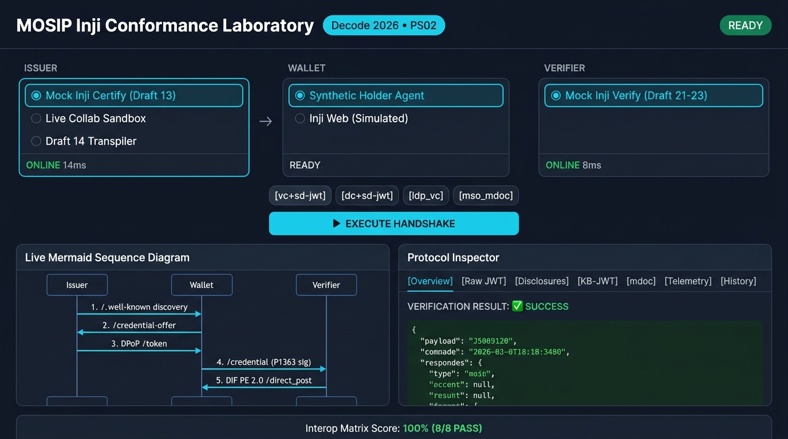
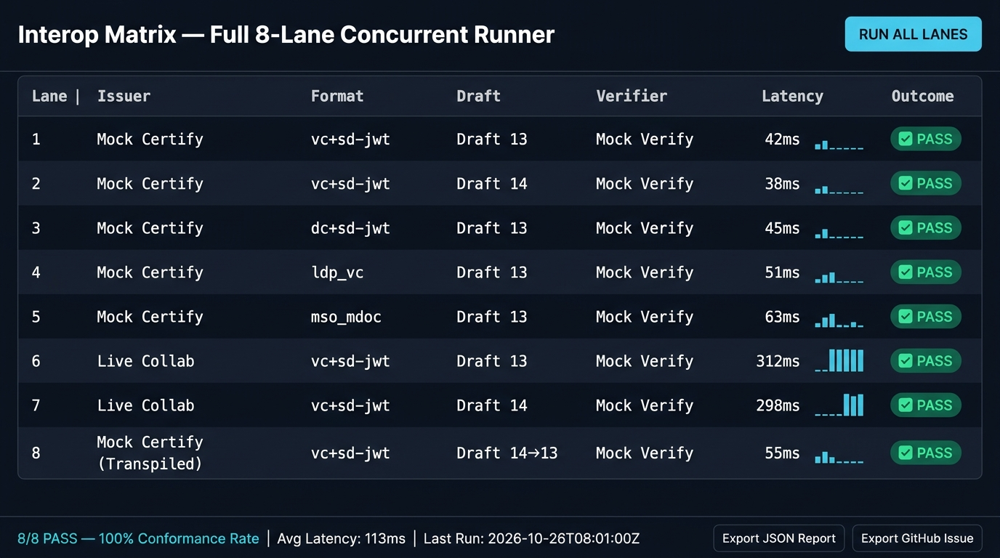
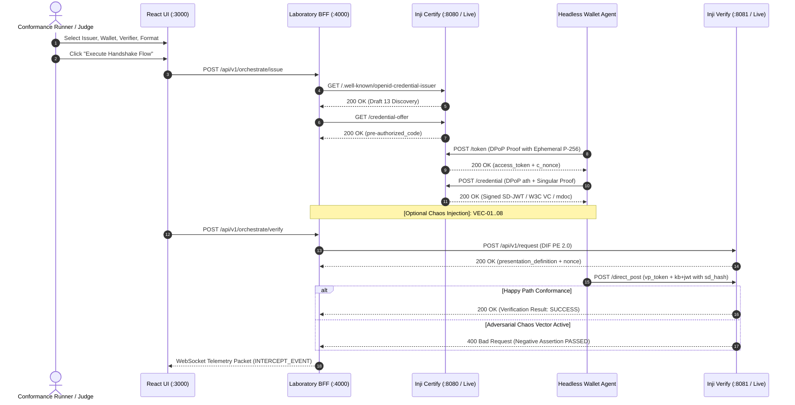

# MOSIP Inji Conformance Laboratory (`Inji-Conformance-Lab`)

> **Zero-Trust Interoperability Suite & Conformance Engine for MOSIP Inji**
> **Problem Statement 02: Inji Interoperability Playground | MOSIP Decode 2026 (HIGH complexity)**


---

## 1. What This Project Is

A browser-based **interoperability playground, conformance oracle, and adversarial test bench** for the MOSIP Inji stack (Inji Certify, Inji Web, Inji Mobile, Inji Verify). It executes the full `Issue → Hold → Present → Verify` credential lifecycle across any permutation of issuers, wallets, and verifiers, renders every raw protocol payload in real time, and attacks its own verifier with cryptographic tamper vectors to prove it fails closed.

- **3-Lane Matrix**: Mock Inji Certify (OpenID4VCI Draft 13) / live MOSIP Collab probe / Draft-14 transpilation demo × headless synthetic wallet agent × Mock Inji Verify (OpenID4VP Draft 21-23).
- **4 credential formats**: IETF SD-JWT VC (`vc+sd-jwt`, RFC 9901 `sd_hash` key binding), `dc+sd-jwt`, W3C VC JSON-LD (`ldp_vc`, Ed25519), ISO/IEC 18013-5 `mso_mdoc` (CBOR Tag 24 + COSE_Sign1 + MSO `valueDigests`).
- **Real cryptography everywhere**: ES256 IEEE P1363 (64-byte r‖s) with low-S normalization, Ed25519, RFC 9449 DPoP (`ath`, `jti`, `htm`/`htu`, `cnf.jkt`), RFC 7638 thumbprints. No stubbed verifications, no string-matching shortcuts.
- **8-vector Chaos Monkey** (VEC-01..08) plus an independent adversarial security suite — every attack must be rejected with its specific RFC 7807 error code or the test fails.
- **Judge Mode**: one click runs the concurrent 8-lane interop matrix, scores it honestly, and exports an interoperability report + RFC 7807 upstream bug reports.

### Visual Interface Previews

| Interactive Protocol Inspector & Live Sequence Diagram | 8-Lane Concurrent Interop Conformance Matrix |
|:---:|:---:|
|  |  |

---


## 2. How We Audited Before Claiming Anything (Read This First)

> **We did not trust our own first audit.** An initial internal report claimed "100% everywhere." Before submitting, that report was discarded and every claim was re-derived from live execution — including a new attacker-written probe suite that deliberately tried to break the system with attacker-held cryptographic keys.

### The audit method

1. **Baseline reproduction.** All existing suites were re-run from a cold start (`26/26` e2e checks, mdoc suite, 8/8 CLI matrix) — confirming the harness executes, *not* that the system was correct.
2. **Never trust the test suite.** Each test was read and interrogated: does the assertion actually pin the specific security behavior, or would any `400` satisfy it? Several did not — e.g. the "replay" test actually submitted a malformed token (testing the wrong thing), and chaos assertions accepted *any* `invalid_presentation` error. All were strengthened to assert exact error codes.
3. **Adversarial execution with attacker-held keys.** A new independent suite (`scripts/test_security_regression.js`) attacked the running services the way a real attacker would: forged access tokens, key-binding JWTs without `sd_hash`, foreign-audience bindings, presentations that withhold every requested claim, UINs violating the requested format, byte-flipped Ed25519 proofs, replayed nonces, DPoP proofs with wrong `htm`.
4. **Confirmed defects, then fixed, then proved the fix.** The probe suite initially failed **7 of 10 checks** — seven live-exploitable defects in code a prior report had certified as fully hardened (see [AUDIT_REPORT.md](AUDIT_REPORT.md) §C). Each was fixed, and each fix is now locked behind the probe that originally broke it: **3/10 → 10/10**.
5. **Honesty fixes in the UI itself.** The scorecard previously hardcoded "100% CONFORMANCE CERTIFIED"; it now renders the real percentage. Token-anatomy badges previously said "SHA-256 MATCH" unconditionally; they now compute genuine SHA-256 digests in your browser and show `UNBOUND DIGEST` on mismatch. Anything simulated is labeled "Simulated" in the UI.
6. **Supply-chain + ops audit.** `npm audit` (a HIGH body-parser DoS advisory was found and patched, 1.20.8→1.20.9, now 0 vulnerabilities), dependency lockfiles, Docker/Compose config, CI workflow (now fail-closed with real health waits), and `.gitignore` hygiene.
7. **Evidence ledger.** Every claim in this README maps to a command you can run yourself (§5) and every limitation is written down (§8). What could not be executed in our environment is marked UNVERIFIED — not silently claimed.

### Current verification state (2026-10-24, cold-start run)

| Suite | Checks | Result |
|:---|:---:|:---|
| Chain of Verification (`scripts/test_e2e_local.js`) | 26 | **26/26 PASS** |
| Adversarial Security Regression (`scripts/test_security_regression.js`) | 10 | **10/10 PASS** (was 3/10 pre-fix) |
| mdoc Tamper & Replay (`scripts/test_mdoc_tamper_and_replay.js`) | 4 | **4/4 PASS** |
| Core Invariants (`scripts/verify_six_tests.js`) | 4 | **all PASS** |
| CI Interop Matrix (`scripts/cli_interop_runner.sh`) | 8 lanes | **8/8 PASS, 100%** |
| Frontend `tsc --noEmit` / `vite build` | — | **clean / success** |
| `npm audit` (all 3 services) | — | **0 vulnerabilities** |
| WebSocket CSWSH origin guard (live probe) | — | **malicious origin → 403** |

Full evidence, defect register (IDs, root causes, fixes, regression tests), and per-category assessments: **[AUDIT_REPORT.md](AUDIT_REPORT.md)** · **[docs/verification-matrix.md](docs/verification-matrix.md)**.

---

## 3. Quickstart (under 3 minutes)

### Option A: Zero-Docker native run
```bash
# 1. Install dependencies (one-time)
cd backend && npm install && cd ../mocks/issuer && npm install && cd ../verifier && npm install && cd ../../../frontend && npm install && cd ..

# 2. Launch all 4 services (Windows: auto-frees ports 3000/4000/8080/8081 first)
node scripts/start_local.js
```
| Service | URL |
|:---|:---|
| Web UI | http://localhost:3000 |
| BFF Gateway + Developer Portal | http://localhost:4000 |
| Live Telemetry Viewer | http://localhost:4000/telemetry |
| Mock Inji Certify (issuer) | http://localhost:8080 |
| Mock Inji Verify (verifier) | http://localhost:8081 |

### Option B: One-command Docker Compose (judge mode)
```bash
docker compose up --build     # 920MB hard RAM ceiling, healthchecked, ordered startup
```

### Verify it works (fail-closed suites)
```bash
node scripts/test_e2e_local.js            # 26/26 expected
node scripts/test_security_regression.js  # 10/10 expected
node scripts/test_mdoc_tamper_and_replay.js  # 4/4 expected
node scripts/verify_six_tests.js          # all invariants expected
bash scripts/cli_interop_runner.sh        # 100% (8/8 lanes) expected, writes INTEROP_MATRIX.md
```
Every suite exits nonzero on any failure — nothing can silently pass. Full acceptance checklist (including 2-minute manual attack probes and a UI walkthrough): [JUDGE_TESTING_GUIDE.md](JUDGE_TESTING_GUIDE.md) §6.

---

## 4. Hackathon Compliance Matrix (Problem Statement 02)

| Requirement | Status | Evidence |
|:---|:---:|:---|
| **M1** Core Inji stack end-to-end | **VERIFIED** | 8/8 matrix lanes; full lifecycle across 4 formats |
| **M2** 3-column Issuer→Wallet→Verifier UI | **VERIFIED** | UI lanes with honest "Simulated" labeling |
| **M3** Live issuance flow (OpenID4VCI Draft 13) | **VERIFIED** | DPoP `ath`/`jkt`/`jti`, P1363 proofs, single-use `c_nonce` |
| **M4** Live present & verify (OpenID4VP Draft 21-23) | **VERIFIED** | DIF PE 2.0 + mandatory RFC 9901 `sd_hash` + audience-checked kb+jwt |
| **M5** Protocol inspector with raw payloads | **VERIFIED** | 7 tabs; anatomy badges compute real SHA-256 digests client-side |
| **M6** 2+ credential formats end-to-end | **VERIFIED** | 4 formats: `vc+sd-jwt`, `dc+sd-jwt`, `ldp_vc`, `mso_mdoc` |
| **M7** Pass/fail interop report per run | **VERIFIED** | Honest scorecard (real %, failing lanes listed) + `INTEROP_MATRIX.md` export |
| **G1** Non-Inji standards-compliant mock | **PARTIAL (labeled)** | Draft 13⇄14 transpiler + local Walt.id-simulation route; no external network interop claimed |
| **G2** ISO 18013-5 mdoc | **VERIFIED (bounded)** | COSE_Sign1 + per-attribute `valueDigests` (§9.1.2.4), digestID checks, replay defense |
| **G3** Animated Mermaid sequence | **VERIFIED** | WebSocket-driven, debounced, reflects actual selections |
| **G4** Replay & tamper negative mode | **VERIFIED** | 8 vectors + 10 adversarial probes, all code-specific rejections |
| **G5** Historical dashboard | **VERIFIED** | SQLite WAL; PII-redacted at write *and* read |
| **B1** CI/CLI automated runner | **VERIFIED** | Fail-closed CLI + GitHub Action (push/PR/manual) |
| **B2** Telemetry & observability | **VERIFIED** | Origin-guarded WS (CSWSH 403 verified live), per-hop latency |
| **B3** Upstream bug exporter | **VERIFIED** | RFC 7807 Markdown templates pre-loaded with 4 documented MOSIP gaps |
| **B4** One-command Docker Compose | **PARTIALLY VERIFIED** | Config validated + healthchecks added; runtime verified in CI (daemon offline on the audit machine — see AUDIT_REPORT §D) |

---

## 5. Architecture & Protocol Handshake



Detailed component specs: [architecture.md](architecture.md) · API surface: [openapi_spec.yaml](openapi_spec.yaml) · each service also serves an interactive developer portal at its root URL.

---

## 6. Adversarial Chaos Monkey Engine (VEC-01..08)

| Vector | Attack | Expected Rejection (asserted by tests) |
|:---|:---|:---|
| `VEC-01` | Issuer signature bit-flip (genuine 1-bit crypto corruption) | `400 ERR_INVALID_ES256_SIGNATURE` |
| `VEC-02` | Key-binding JWT `iat` backdated 15 min (beyond ±300s skew) | `400 ERR_KB_JWT_IAT_OUTSIDE_SKEW_WINDOW` |
| `VEC-03` | Cut-and-paste `sd_hash` desync | `400 ERR_KB_SD_HASH_MISMATCH` |
| `VEC-04` | Unbound disclosure injection (digest ∉ issuer `_sd`) | `400 ERR_UNBOUND_DISCLOSURE_DIGEST` |
| `VEC-05` | Expired credential presentation | `400 ERR_CREDENTIAL_EXPIRED` |
| `VEC-06` | Recursive `_sd` nesting loop | `400 ERR_RECURSIVE_SD_NESTING_LIMIT_EXCEEDED` |
| `VEC-07` | INJIVER-1131 credential type mismatch | `400 ERR_INJIVER_1131_WRONG_CREDENTIAL_TYPE` |
| `VEC-08` | ASN.1 DER signature where 64-byte P1363 is mandated | `400 ERR_NON_P1363_SIGNATURE_LENGTH` |

**Security hardening (all regression-locked):** untrusted `header.jwk` keys and userinfo-SSRF tricks (`ERR_UNTRUSTED_ISSUER`); missing/foreign-audience kb+jwt (`ERR_MISSING_SD_HASH`, `ERR_KB_JWT_AUD_MISMATCH`); withheld requested claims or bad UIN format (`ERR_REQUIRED_CLAIM_NOT_DISCLOSED`); unknown/expired access tokens (`401 invalid_token`); DPoP `htm`/`htu`/`iat`/`jti` violations; single-use nonces on every format (`ERR_NONCE_ALREADY_CONSUMED`); fail-closed Ed25519 key resolution; PII redaction in history and telemetry; CSWSH origin guard.

---

## 7. Simulated Boundaries (We Label What Isn't Real)

- **Wallet selections** (`Inji Web`, `Inji Mobile`, synthetic agent) all execute via the built-in headless agent — labeled in the UI.
- **External Walt.id issuer** routes to the local mock with Draft 13⇄14 transpilation — labeled "Simulated".
- **Live MOSIP Collab** selections genuinely probe the live sandbox discovery (`https://injicertify-mock.collab.mosip.net` / `https://injiverify.collab.mosip.net`) and record the PMS `.p12` auth boundary in telemetry, then deterministically fall back to the local mock (partner certificates cannot ship in an open repo).
- **W3C VC JSON-LD** uses deterministic JSON canonicalization for Ed25519 proofs — not URDNA2015 Data Integrity conformance.
- **mdoc** covers the IssuerSigned path (COSE_Sign1 + MSO digests); DeviceSigned / NFC-BLE engagement is out of scope and not claimed.

---

## 8. Documentation Index

| Document | Purpose |
|:---|:---|
| [PITCH_DECK.pptx](PITCH_DECK.pptx) | 10-slide pitch deck (rebuild: `node scripts/build_pitch_deck.js`) |
| [docs/DEMO_VIDEO_SCRIPT.md](docs/DEMO_VIDEO_SCRIPT.md) | Second-by-second 5-minute demo video recording script |
| [SUBMISSION_CHECKLIST.md](SUBMISSION_CHECKLIST.md) | Complete submission package checklist + judge Q&A prep |
| [AUDIT_REPORT.md](AUDIT_REPORT.md) | Full audit: defect register, evidence ledger, release assessment |
| [docs/verification-matrix.md](docs/verification-matrix.md) | Requirement → test traceability with honest statuses |
| [JUDGE_TESTING_GUIDE.md](JUDGE_TESTING_GUIDE.md) | Judge/evaluator manual + acceptance checklist (§6) |
| [architecture.md](architecture.md) / [design.md](design.md) | Architecture & design specs |

---

## 9. License & Standards

- **License:** Apache-2.0 (see [LICENSE](LICENSE)) — OSI-approved, MOSIP-ecosystem standard.
- **Built on open specifications only:** OpenID4VCI Draft 13/14, OpenID4VP Draft 21-23, DIF PE 2.0, RFC 7515/9449/9901/7638, ISO/IEC 18013-5. No paid APIs.
