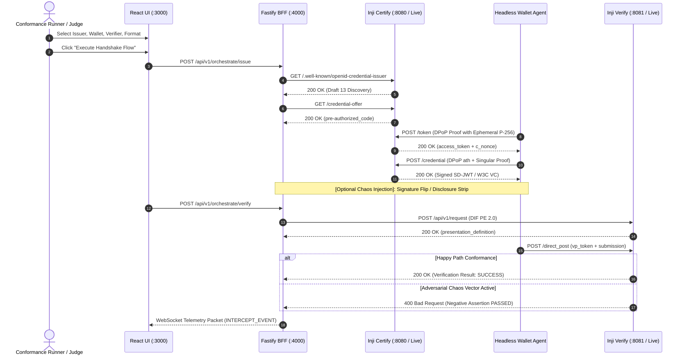

# MOSIP Inji Conformance Laboratory (`Inji-Conformance-Lab`)
> **Zero-Trust Interoperability Suite & Conformance Engine for MOSIP Inji**  
> **Problem Statement 02: Inji Interoperability Playground | MOSIP Decode 2026**


---

## 1. Executive Summary: What is this Project?

The **MOSIP Inji Conformance Laboratory** is an enterprise-grade conformance testing, protocol inspection, and adversarial fuzzing platform designed to prove cross-ecosystem interoperability for the **MOSIP Inji stack** (`Inji Certify`, `Inji Web`, `Inji Mobile`, `Inji Verify`).

Modeled after the official OpenID Foundation (OIDF) and W3C conformance suites, it provides:
1. **Interactive 3-Lane Matrix**: Seamlessly interconnect any permutation of:
   - **Issuers**: MOSIP Collab Inji Certify (Live), Mock Inji Certify (Draft 13 Local), External Walt.id (Draft 14).
   - **Wallets**: Automated Headless Synthetic Agent, Inji Web Browser Bridge, Inji Mobile QR Bridge (Claim-169).
   - **Verifiers**: MOSIP Collab Inji Verify (Live), Mock Inji Verify (Draft 21–23 Local).
2. **Multi-Format Cryptographic Engine**:
   - **IETF SD-JWT VC**: Selective disclosure claim unspooling with real-time SHA-256 digest validation and holder key-binding JWT (`kb_jwt`).
   - **W3C VC JSON-LD**: `Ed25519Signature2020` canonicalization and proof validation.
   - **ISO/IEC 18013-5 mdoc**: CBOR Tag 24 (`#6.24`) wrapper and `COSE_Sign1` Mobile Security Object inspector.
3. **5-Layer Adversarial Chaos Monkey Engine**:
   - Injects cryptographic bit-flips, disclosure stripping, nonce mutations, and expiration backdating.
   - Verifies that relying parties fail-closed with deterministic HTTP 400 rejection codes.
4. **Judge Mode (1-Click Automated Matrix)**:
   - Executes all 8 combinatorial lifecycle permutations and negative tests in under 3 seconds.
   - Generates an exportable conformance scorecard and SVG certification badge.

---

## 2. 3-Minute Quickstart

### Option A: Local Native Node Run
```bash
# 1. Install dependencies
cd backend && npm install
cd ../mocks/issuer && npm install
cd ../mocks/verifier && npm install
cd ../frontend && npm install
cd ..

# 2. Run automated test suite to verify 100% conformance
node scripts/test_e2e_local.js

# 3. Start local development server
# Terminal 1: Mock Issuer (:8080)
node mocks/issuer/server.js

# Terminal 2: Mock Verifier (:8081)
node mocks/verifier/server.js

# Terminal 3: Backend BFF & Telemetry WebSocket (:4000)
node backend/server.js

# Terminal 4: Frontend UI (:3000)
cd frontend && npm run dev
```

Visit **`http://localhost:3000`** in your browser.

### Option B: One-Command Docker Compose
```bash
# Start all containers under strict 1.5GB RAM constraints
docker compose up --build
```
- Frontend UI: `http://localhost:3000`
- BFF Gateway & WebSocket: `http://localhost:4000`
- Mock Issuer: `http://localhost:8080`

---

## 3. High-Level Architecture & Protocol Handshake



---

## 4. Adversarial Chaos Monkey Engine: Test Vectors

| Attack Vector | Layer | Mutation Target & Action | Expected Status |
| :--- | :--- | :--- | :--- |
| `SIG_FLIP` | Layer 1 (Crypto) | Alter final byte of Base64URL signature to `Z` | `400 invalid_signature` |
| `STRIP_DISCLOSURES` | Layer 4 (Selective Disclosure) | Truncate SD-JWT at first `~` delimiter | `400 invalid_presentation` |
| `MUTATE_NONCE` | Layer 3 (Holder Binding) | Mutate `kb_jwt.nonce` to trigger replay failure | `400 invalid_presentation` |
| `BACKDATE_EXP` | Layer 2 (Temporal) | Backdate `exp` by 600s (exceeds 300s clock-skew) | `400 expired_credential` |

---

## 5. Live MOSIP Collab Sandbox Endpoints

- **Live Inji Certify (Issuer)**: `https://injicertify-mock.collab.mosip.net`
- **Live Inji Verify (Verifier)**: `https://injiverify.collab.mosip.net`
- **Issuer Discovery Path**: `/.well-known/openid-credential-issuer` (Unauthenticated open access)

---

## 6. License & Hackathon Standards

- **License**: Apache-2.0 Open Source License.
- **Code of Conduct**: Adheres strictly to the Contributor Covenant.
- **No Paid APIs**: Built entirely with open source standards (`jose`, `cbor-x`, `React`, `Fastify`, `Express`, `Mermaid.js`).
