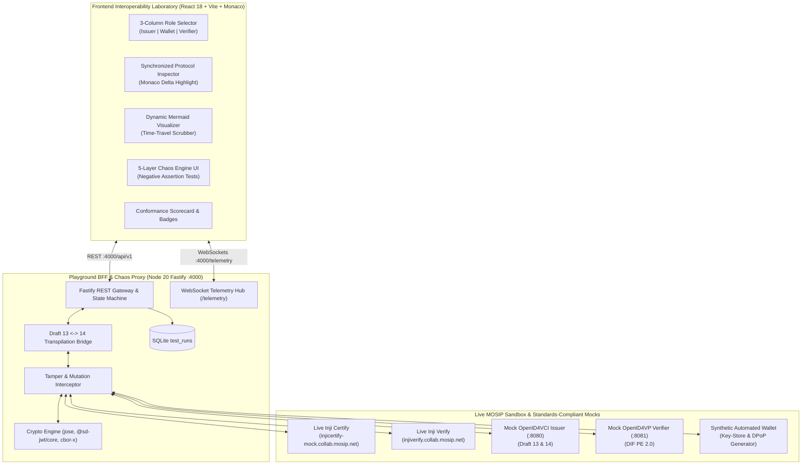

# MOSIP INJI INTEROPERABILITY LABORATORY (INJI-CONFORMANCE-LAB)
## State-of-the-Art Enterprise Architecture & Research Review Dossier
### Problem Statement 02: Inji Interoperability Playground | MOSIP Decode 2026

---

## 1. Executive Summary: Elevating to World-Class Industrial Level

Standard hackathon entries build simple, linear "happy-path" demos that trigger an issuance and show a green checkmark. **The Inji Interoperability Laboratory (Inji-Conformance-Lab)** is engineered as a **production-grade, zero-trust Conformance & Certification Engine** modeled after the OpenID Foundation (OIDF) and W3C Conformance Test Suites.

It addresses the fundamental crisis in the global Verifiable Credential industry: **spec fragmentation, cross-draft incompatibilities, and subtle cryptographic edge-case failures between national identity stacks (MOSIP) and external international wallets (Walt.id, Sphereon, EUDI Wallets).**

---

## 2. Audit of Existing Baseline Changes Made to Date

The following foundational contracts and infrastructure specifications have been established in the repository:

| File Path | Purpose & Architectural Role | Specifications Encapsulated |
| :--- | :--- | :--- |
| [`docker-compose.yml`](file:///c:/Users/ASUS/Desktop/Hackathons/MOSIP/docker-compose.yml) | Multi-container local orchestration under strict 1.5GB RAM constraints. | Services: `inji-lab-ui` (256M), `inji-lab-bff` (512M), `mock-certify` (256M) on bridge network `inji-net`. |
| [`openapi_spec.yaml`](file:///c:/Users/ASUS/Desktop/Hackathons/MOSIP/openapi_spec.yaml) | Standard OpenAPI 3.0 contract for the BFF Orchestration Gateway. | Endpoints: `/orchestrate/issue`, `/orchestrate/verify`, with schemas for credential formats, issuer/verifier types, and tamper config. |
| [`fixtures/sample_credentials.json`](file:///c:/Users/ASUS/Desktop/Hackathons/MOSIP/fixtures/sample_credentials.json) | Verified W3C VC JSON-LD credential fixture for MOSIP Identity. | Implements `Ed25519Signature2020`, `did:web:injicertify-mock.collab.mosip.net`, and canonical UIN claims. |
| [`fixtures/tamper_vectors.json`](file:///c:/Users/ASUS/Desktop/Hackathons/MOSIP/fixtures/tamper_vectors.json) | Cryptographic mutation vectors for adversarial testing. | Vectors: Signature bit-flip (`tamper_sig_flip`), SD-JWT disclosure truncation (`tamper_sd_jwt_disclosure_strip`), and KB-JWT nonce mutation (`tamper_kb_jwt_nonce`). |
| [`db/schema.sql`](file:///c:/Users/ASUS/Desktop/Hackathons/MOSIP/db/schema.sql) | SQLite relational schema for persistent test runs. | Table `test_runs` with columns `id`, `timestamp`, `issuer_type`, `verifier_type`, `format`, `status`, `latency_ms`, `tamper_applied`, `trace_blob`. |
| [`scripts/cli_interop_runner.sh`](file:///c:/Users/ASUS/Desktop/Hackathons/MOSIP/scripts/cli_interop_runner.sh) | Automated headless test execution harness. | Runs headless test permutations and writes markdown results to `INTEROP_MATRIX.md`. |
| [`.github/workflows/interop-matrix.yml`](file:///c:/Users/ASUS/Desktop/Hackathons/MOSIP/.github/workflows/interop-matrix.yml) | Continuous Integration pipeline for automated conformance. | Spins up Docker Compose, executes interop runner, and posts summary tables to GitHub Actions Job Summary. |
| [`memory.md`](file:///c:/Users/ASUS/Desktop/Hackathons/MOSIP/memory.md) | Exhaustive 50-point technical knowledge base. | Ground truth on live sandbox URLs, OIDC Draft 13/14 differences, crypto formulas, and protocol error codes. |
| [`tasks.md`](file:///c:/Users/ASUS/Desktop/Hackathons/MOSIP/tasks.md) | Work Breakdown Structure & Milestone Tracker. | 5-phase schedule tracking development through October 26, 2026. |

---

## 3. Seven Industrially Relevant World-Class Features

To achieve world-class distinction without violating any constraints (offline Docker Compose, <1.5GB RAM, 5-day timeline, no paid APIs), the platform introduces 7 high-impact enterprise capabilities:

### Feature 1: Multi-Profile Conformance Certification Suite
Instead of generic pass/fail tests, the laboratory evaluates credentials against 3 formal international profiles:
1. **MOSIP National ID Profile**: Strict W3C VC JSON-LD 1.1 with `Ed25519Signature2020` or `JsonWebSignature2020`, URDNA2015 canonicalization, and National Identity attributes (`UIN`, `fullName`, `gender`, `dob`).
2. **eIDAS 2.0 / EUDI Wallet Profile**: IETF SD-JWT VC (`draft-ietf-oauth-sd-jwt-vc`), ES256 algorithm, mandatory holder Key Binding JWT (`kb_jwt`) with audience and fresh nonce binding, and fine-grained claim selective disclosure.
3. **ISO/IEC 18013-5 mDL Profile**: Binary CBOR Tag 24 (`#6.24`) wrapper enclosing `COSE_Sign1` signed `MobileSecurityObject` (MSO) with driving privilege claims.

### Feature 2: 5-Layer Adversarial Mutation & Chaos Engine
Industry reliance on VCs requires verifying that Relying Parties fail securely (fail-closed) when encountering corrupted or forged credentials. The Chaos Engine injects 10 deterministic failure modes across 5 layers:
- **Layer 1: Cryptographic Integrity**: Bit-flip in proof signature (`replace_last_char_with_Z`), Algorithm confusion (`alg: "none"`), Unsupported curve injection.
- **Layer 2: Temporal Validity**: Backdated expiration (`exp` in past), Premature issuance (`nbf`/`iat` in future), Excessive clock-skew.
- **Layer 3: Holder Binding & Replay**: Nonce corruption in `kb_jwt`, Audience spoofing (`aud` mismatch), Replay of consumed `c_nonce`.
- **Layer 4: Selective Disclosure Security**: Stripping disclosures while leaving `_sd` digests, Tampering claim text without altering disclosure hash, Duplicate disclosure digests, Orphaned disclosures without `_sd` pointers.
- **Layer 5: Transport & Serialization**: Malformed Content-Type (`application/json` instead of `application/x-www-form-urlencoded` on `/direct_post`), Corrupted CBOR Tag 24 byte envelopes.
*Every vector validates that Inji Verify strictly responds with HTTP 400 and appropriate error strings (`invalid_signature`, `invalid_presentation`).*

### Feature 3: Live Cross-Draft Compatibility & Transpilation Proxy (Draft 13 <-> Draft 14)
- **The Problem**: MOSIP Inji Certify is implemented against OpenID4VCI **Draft 13** (which defines `credentials_supported` as a JSON array). Newer European ecosystem tools (Walt.id, Sphereon, Lissi) use **Draft 14+** (which refactored this into `credential_configurations_supported` as a JSON object with distinct format identifiers).
- **The Industrial Solution**: The BFF includes a transparent **Draft Compatibility Bridge**. When communicating with Draft 14 external issuers or wallets, it dynamically transforms metadata and credential requests on-the-fly, proving how MOSIP can achieve zero-downtime forward-compatibility with European digital identity wallets.

### Feature 4: High-Precision Token Anatomy & Synchronized Protocol Inspector
- Split-screen Monaco Editor featuring **bidirectional delta decorations**.
- Color-coded cryptographic dissection:
  - **JWT Header**: Vibrant Magenta / Pink (`#ec4899`).
  - **JWT Claims Payload**: Cyan (`#06b6d4`).
  - **Cryptographic Signature**: Indigo / Blue (`#6366f1`).
  - **SD-JWT Salted Disclosures**: Emerald Green (`#10b981`).
  - **Holder Key-Binding JWT**: Amber (`#f59e0b`).
  - **ISO mDoc Tag 24 CBOR Envelope**: Violet (`#8b5cf6`).
- Hovering over a claim in the decoded view instantaneously highlights its corresponding Base64URL byte range and SHA-256 digest offset in the raw token stream.

### Feature 5: Real-Time Animated Mermaid.js Sequence Visualizer with Time-Travel Debugging
- Dynamic SVG rendering driven by WebSocket telemetry packets (`INTERCEPT_EVENT`).
- Visually highlights the active protocol hop (e.g., `Wallet ->> Issuer: POST /token [DPoP]`) with latency badge (`42ms`).
- Interactive timeline scrubber allowing developers to step forward, pause, and rewind through each packet in the handshake.

### Feature 6: RFC 7807 Diagnostics & 1-Click Upstream GitHub Issue Generator
- When an interoperability test fails or a protocol discrepancy is discovered, the system formats the diagnostic into an **RFC 7807 (`Problem Details for HTTP APIs`)** JSON payload.
- Provides a **1-Click "Export GitHub Issue"** button that outputs a markdown template complete with:
  - Exact MOSIP module affected (`mosip/inji-certify` or `mosip/inji-verify`).
  - Specification clause violated (e.g., *OpenID4VCI Draft 13, Section 6.2: c_nonce freshness*).
  - Reproducible standalone `curl` command.
  - Raw request/response hex dumps and headers.

### Feature 7: Automated Conformance Badges & CI/CD Certification Matrix
- Standalone CLI runner (`npm run test:interop` / `bash scripts/cli_interop_runner.sh`).
- Exports GitHub-flavored markdown matrices (`INTEROP_MATRIX.md`) and SVG conformance badges (`MOSIP-Inji: Compliant | 100%`).
- Can run natively inside GitHub Actions with zero external dependencies.

---

## 4. End-to-End System Topology & Data Flow

---

## 5. Specific Audit Questions for Deep Research Agent

To ensure this state-of-the-art plan is bulletproof before full implementation, the following questions are submitted for the Deep Research Agent's review:

1. **JWE Response Encryption in OpenID4VP Direct Post**:
   - Inji Verify supports `direct_post.jwt` where the wallet encrypts the presentation using JWE (e.g., ECDH-ES with A256GCM). Does the live Collab sandbox instance ([`https://injiverify.collab.mosip.net`](https://injiverify.collab.mosip.net)) require JWE response encryption by default, or does it accept standard unencrypted `direct_post` with `application/x-www-form-urlencoded`?
2. **DPoP Token Binding Curve Compatibility**:
   - For DPoP proofs sent to Inji Certify during `/token` exchange, does Inji Certify strictly enforce `ES256` (P-256), or does it also accept `EdDSA` (Ed25519) DPoP keys?
3. **Selective Disclosure Array Syntax in DIF Presentation Exchange**:
   - When presenting an SD-JWT VC to Inji Verify via DIF PE 2.0 `input_descriptors`, what is the exact JSONPath syntax accepted for querying nested selective claims (e.g., `$.credentialSubject.UIN` vs top-level `$.UIN`)?
4. **Draft 13 vs Draft 14 Token Proof Structure**:
   - In Draft 13, the `/credential` endpoint proof is passed as `proof: { proof_type: "jwt", jwt: "..." }`. In Draft 14, this was renamed to `proofs: { jwt: "..." }`. Does Inji Certify accept both forms or strictly the Draft 13 object wrapper?
5. **Memory Optimization on Node 20 Fastify**:
   - Under the 512MB RAM limit for the BFF container in `docker-compose.yml`, what is the recommended garbage collection and V8 heap flag setting (`--max-old-space-size=384`) to prevent container OOM kills under rapid fuzzing iterations?

---

## 6. Verification Checklist for Research Agent
- [ ] Conformance to MOSIP Decode Evaluation Criteria (40% Functionality, 40% Deliverables, 10% UX, 10% Pitch).
- [ ] Adherence to strict Apache-2.0 open-source licensing.
- [ ] Guaranteed local execution via single command `docker compose up`.
- [ ] Full offline independence using bundled mocks with optional live Collab sandbox toggle.
