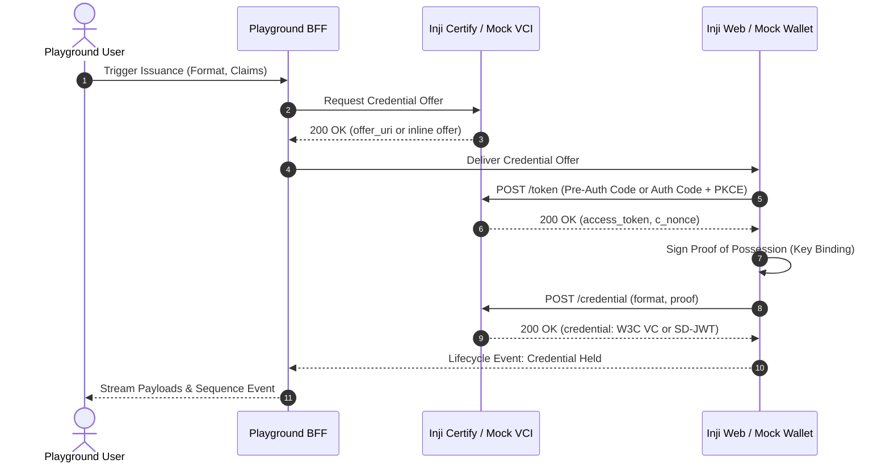
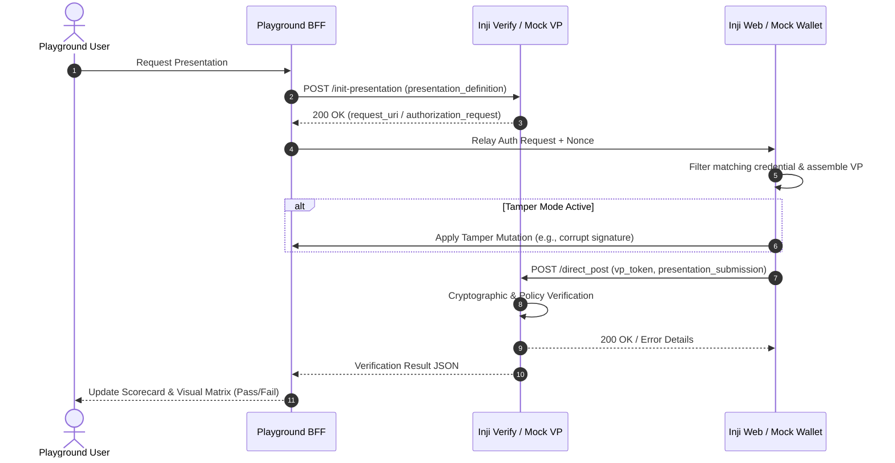

# System Architecture & Technical Specifications
## Project: Inji Interoperability Playground

---

## 1. High-Level System Architecture

```mermaid
graph TB
    subgraph Browser ["Frontend Client (React + TypeScript + Vite)"]
        UI_Matrix["3-Column Role Selector<br/>(Issuer | Wallet | Verifier)"]
        UI_Runner["Lifecycle Runner & Controls"]
        UI_Inspector["Real-Time Protocol Inspector<br/>(Raw Payloads, Decoded JWTs)"]
        UI_Diagram["Dynamic Mermaid Sequence Engine"]
        UI_Tamper["Adversarial Tamper Workbench"]
        UI_History["Historical Reports & Metrics"]
    end

    subgraph BFF ["Playground Backend Orchestrator (Node.js / Express / TypeScript)"]
        WS_Server["WebSocket Event Hub & State Machine"]
        REST_Gateway["REST API Router & Normalizer"]
        Crypto_Engine["Cryptographic Suite<br/>(W3C LD-Proofs, SD-JWT, CBOR/mdoc)"]
        Tamper_Engine["Fault & Tamper Injection Engine"]
        History_Store["SQLite / Local JSON History Store"]
    end

    subgraph InjiCore ["MOSIP Inji Stack / Collab Sandbox"]
        Inji_Certify["Inji Certify<br/>(OpenID4VCI Draft 13 Issuer)"]
        Inji_Mimoto["Mimoto Backend<br/>(Inji Wallet BFF)"]
        Inji_Verify["Inji Verify Service<br/>(OpenID4VP Draft 21-23 RP)"]
    end

    subgraph ExternalMock ["Standards-Compliant External Mocks"]
        Mock_VCI["Mock OpenID4VCI Issuer<br/>(DIF / Walt.id schema)"]
        Mock_Wallet["Automated Wallet Simulator<br/>(Holder Key-Store & Proof Engine)"]
        Mock_VP["Mock OpenID4VP Verifier<br/>(Generic Relying Party)"]
    end

    Browser <==> |WebSocket (Bi-Directional Telemetry)| WS_Server
    Browser <==> |HTTP REST (Controls & Configurations)| REST_Gateway
    
    REST_Gateway --> Inji_Certify
    REST_Gateway --> Inji_Mimoto
    REST_Gateway --> Inji_Verify

    REST_Gateway --> Mock_VCI
    REST_Gateway --> Mock_Wallet
    REST_Gateway --> Mock_VP

    Crypto_Engine --> Tamper_Engine
```

---

## 2. Component Specifications

### 2.1 Frontend: Visual Playground UI
- **Framework**: React 18+ with TypeScript, bundled with Vite for near-instant HMR.
- **Styling**: Modern cyber-minimalist design system with CSS custom properties, dark mode default, high contrast accessibility, and responsive flex/grid layouts.
- **Key Modules**:
  1. `MatrixSelector`: Interactive 3-lane selector for Issuer, Wallet, and Verifier with live latency/ping indicators.
  2. `ProtocolInspector`: Split-screen raw JSON payload inspector, formatted JWT header/payload/signature decoders, and SD-JWT disclosure tree.
  3. `SequenceVisualizer`: Interactive SVG-based Mermaid sequence diagram that animates protocol hops in real time as events occur.
  4. `TamperWorkbench`: Attack vector toggles (Signature mutation, Expired timestamps, DID tampering, Disclosure stripping).
  5. `ReportModal`: Comprehensive audit scorecard with download buttons for Markdown and JSON.

### 2.2 Backend Orchestrator (Playground BFF)
- **Runtime**: Node.js 20+ with TypeScript.
- **Core Responsibilities**:
  1. **Protocol Normalization**: Normalizes responses across Inji Certify, Inji Verify, and external mocks into unified event objects.
  2. **WebSocket Telemetry**: Streams exact HTTP request/response pairs, headers, and protocol timestamps to connected browser sessions.
  3. **Protocol State Machine**: Coordinates multi-step handshakes:
     - *Issuance*: Discovery -> Offer -> Auth Request -> Token -> Proof of Possession -> Credential.
     - *Presentation*: Auth Request with `presentation_definition` -> Submission -> Verification -> Evaluation.
  4. **Dynamic Tamper Injection**: Intercepts VCs/VPs in-flight when tamper mode is enabled to test edge-case rejection.

### 2.3 Cryptographic & Standards Engine
- **W3C VC 1.1 / 2.0**:
  - Validates JSON-LD structures and canonicalization (`URDNA2015`).
  - Verifies `Ed25519Signature2020` and `JsonWebSignature2020`.
- **IETF SD-JWT VC**:
  - Implements disclosure generation: `sha-256(disclosure_bytes)` digests.
  - Verifies key-binding JWT (`kb_jwt`) containing nonce and verifier audience.
- **ISO/IEC 18013-5 mdoc (Synthetic)**:
  - Decodes CBOR byte streams, inspects IssuerAuth `COSE_Sign1`, and decodes Mobile Security Objects (`MSO`).

---

## 3. Communication Protocols & Data Flows

### 3.1 Issuance Flow (OpenID4VCI Draft 13)


### 3.2 Presentation Flow (OpenID4VP Draft 21–23)


---

## 4. Deployment Topology & Docker Orchestration

The entire system is packaged as a unified, one-command Docker Compose stack:

```yaml
version: '3.8'

services:
  playground-ui:
    build:
      context: ./frontend
      dockerfile: Dockerfile
    ports:
      - "3000:3000"
    environment:
      - VITE_BFF_URL=http://localhost:4000
    depends_on:
      - playground-bff

  playground-bff:
    build:
      context: ./backend
      dockerfile: Dockerfile
    ports:
      - "4000:4000"
    environment:
      - PORT=4000
      - INJI_CERTIFY_URL=http://inji-certify-mock:8080
      - INJI_VERIFY_URL=http://inji-verify-mock:8081
    depends_on:
      - inji-certify-mock
      - inji-verify-mock

  inji-certify-mock:
    build:
      context: ./mocks/certify
      dockerfile: Dockerfile
    ports:
      - "8080:8080"

  inji-verify-mock:
    build:
      context: ./mocks/verify
      dockerfile: Dockerfile
    ports:
      - "8081:8081"
```

---

## 5. Security & Boundary Rules
1. **Key Isolation**: Ephemeral cryptographic keys generated for test holders are never persisted in plaintext outside the sandbox.
2. **CORS & Reverse Proxying**: Playground BFF acts as an explicit CORS-compliant reverse proxy to prevent cross-origin browser blocking.
3. **Deterministic Mocking**: All mock endpoints reproduce exact HTTP headers, standard error structures, and DPoP/nonce handshakes specified by OpenID Foundation profiles.
